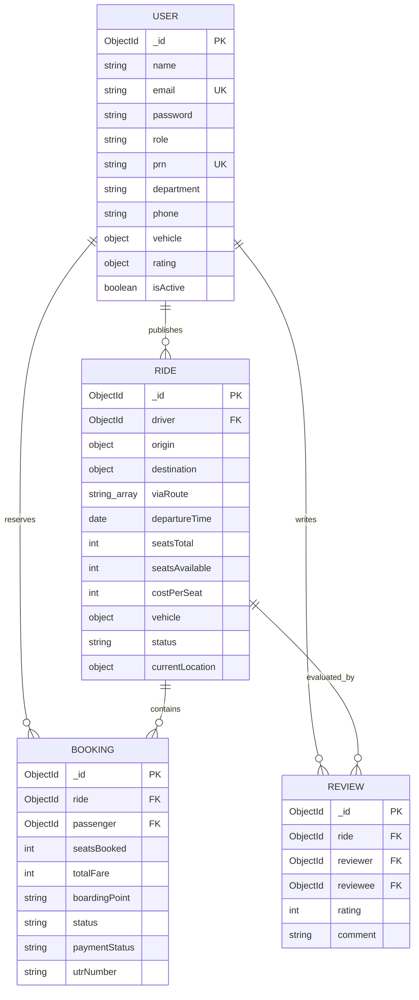
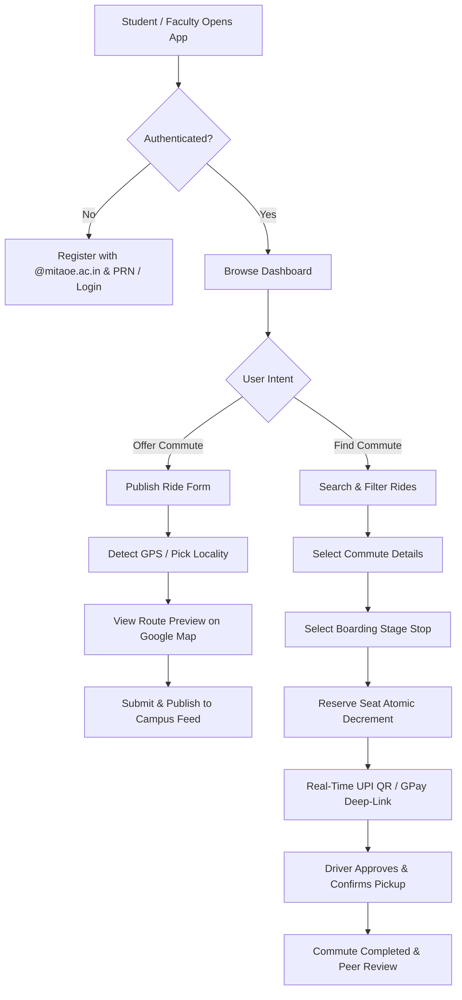

# MITAOE Campus Carpool — Project Documentation
## Full-Stack Web Development Mini-Project Report

---

**Project Title:** MITAOE Campus Carpool — Verified Intra-Campus Ride Sharing & Green Commute Platform  
**Academic Year:** 2026–2027  
**Student Name:** Prathmesh Bhadule  
**PRN / Roll No:** `[Enter Your PRN Here, e.g., 122100451001]`  
**Department:** Department of Computer Engineering / Software Engineering  
**Institute:** MIT Academy of Engineering (MITAOE), Alandi (D.), Pune  
**Course / Subject:** Full-Stack Web Development Mini-Project (MERN)  
**Total Marks:** 10  
**Live Production URL:** `https://campus-carpool.onrender.com`  
**GitHub Repository:** `https://github.com/Prathmeshbhadule/campus-carpool`  

---

## 1. Problem Statement & Real-World Motivation

### 1.1 The Commuter Challenge at MITAOE Alandi
MIT Academy of Engineering is situated in Alandi, approximately 18 to 35 kilometers away from central Pune and PCMC residential hubs such as Wakad, Baner, Kothrud, Hadapsar, Nigdi, and Viman Nagar. Over 4,000 students and 300 faculty members travel daily along heavily congested corridors (Dighi Hills, Bhosari MIDC, Spine Road, Pune-Alandi Road). 

Key challenges observed on campus:
1. **Public Transit Bottlenecks:** PMPML buses serving Alandi are overcrowded, irregular, and involve multiple transfers.
2. **Exorbitant Solo Cab Costs:** Private cab aggregators (Ola/Uber) charge between ₹350 and ₹700 for a one-way trip, making solo commuting financially unsustainable for college students.
3. **Severe Environmental Impact:** Hundreds of students and staff travel along the exact same routes at the exact same morning hours in single-occupancy two-wheelers and four-wheelers, generating hundreds of metric tons of avoidable $\text{CO}_2$ emissions.
4. **Safety & Stranger Anxiety:** Commercial ridesharing apps connect users with unverified strangers. Students and faculty require an exclusive, institutional trust boundary where every participant is a verified campus member.

### 1.2 Proposed Solution
**MITAOE Campus Carpool** is a full-stack, production-grade MERN web platform exclusively restricted to verified college stakeholders (`@mitaoe.ac.in`). It bridges empty vehicle seats with students and colleagues along 36 Pune/PCMC corridors, incorporating atomic seat reservations, real-world Leaflet & Google Maps route visualization, live hardware GPS detection, instant UPI QR payments with deep-link mobile app launchers, and scientific carbon emissions offset metrics.

---

## 2. Scope & Objectives

* **Restricted Institutional Access:** Enforce institutional security by restricting sign-ups strictly to `@mitaoe.ac.in` email addresses with mandatory 12-digit student PRN verification.
* **Dual-Role Flexibility:** Empower any college user to seamlessly operate as both a **Driver** (publishing commutes) and a **Rider** (booking seats on other routes) from a unified dashboard.
* **Geographical Route Intelligence:** Integrate interactive Leaflet and Google Maps displaying origin pickup spots, intermediate waypoints (via-routes), and destination campus gates with real-world distance calculation.
* **Live Hardware GPS Telemetry:** Provide one-click physical GPS auto-detection to locate the driver's current position, match the closest Pune locality, and calculate fair route costs.
* **Atomic Concurrency-Safe Reservations:** Implement MongoDB atomic condition queries (`findOneAndUpdate`) to prevent overbooking race conditions when multiple users book the final available seat simultaneously.
* **Stage Fare & Proportional Pricing:** Dynamically compute pro-rated stage pricing when riders board at intermediate stops along the route.
* **Real-Time NPCI UPI QR & Deep-Linking:** Generate scannable UPI QR codes and 1-tap mobile app intents (Google Pay, PhonePe, Paytm, BHIM) with automated UTR confirmation and digital receipts.
* **Green Transit Carbon Accounting:** Scientifically measure fuel savings, expense reduction vs. commercial Pune cabs, and kilograms of $\text{CO}_2$ emissions eliminated per carpool.

---

## 2.1 Mapping to UN Sustainable Development Goals (SDGs)

This project directly aligns with **5 United Nations Sustainable Development Goals (UN SDGs)**, addressing urban transit bottlenecks, environmental degradation, and resource efficiency:

| SDG Icon & Number | Goal Title | Primary Target Addressed | Project Implementation & Contribution |
| :--- | :--- | :--- | :--- |
| **SDG 11** 🏙️ | **Sustainable Cities and Communities** | **Target 11.2:** Safe, affordable, accessible, and sustainable transport systems for all | Consolidates individual commuter trips across 36 Pune/PCMC corridors into shared commutes, directly easing traffic congestion, bottleneck delays along Alandi Road, and pressure on overloaded public transit. |
| **SDG 13** 🌍 | **Climate Action** | **Target 13.2:** Integrate climate change measures into strategies and planning | Features an interactive **$\text{CO}_2$ Emissions Estimator** calculating avoided vehicular emissions: $\Delta \text{CO}_2 = (N - 1) \times d \times E_f$. By grouping 3–4 commuters into 1 vehicle, each commute eliminates up to 60–75% of carbon emissions. |
| **SDG 12** ♻️ | **Responsible Consumption and Production** | **Target 12.2:** Sustainable management and efficient use of natural resources | Maximizes vehicle asset utilization through shared mobility, significantly reducing per-capita fossil fuel consumption (Petrol, Diesel, CNG) among college students and faculty. |
| **SDG 9** 💡 | **Industry, Innovation, and Infrastructure** | **Target 9.4:** Upgrade infrastructure with clean and environmentally sound technologies | Builds resilient digital campus transit infrastructure featuring real-world Leaflet & Google Maps routing, live hardware GPS telemetry, and instant NPCI-compliant UPI QR payment integration. |
| **SDG 3** 💚 | **Good Health and Well-Being** | **Target 3.9:** Substantially reduce illnesses and deaths from air pollution | Fewer running vehicle engines decreases toxic vehicular exhaust ($PM_{2.5}$, $PM_{10}$, $NO_x$, $CO$) along college routes, mitigating respiratory hazards and commute-induced physical/mental stress. |

---

## 3. Technology Stack & Architectural Overview

The application follows a modular, decoupled **MERN (MongoDB, Express, React, Node.js)** architecture with responsive front-end styling and containerized cloud deployment.

```
┌────────────────────────────────────────────────────────────────────────┐
│                        CLIENT LAYER (React 19 + Vite)                  │
│   • Bootstrap 5.3 + Responsive Custom CSS      • Leaflet Map Views    │
│   • React Router v6 (Protected Routes)         • Dynamic QR Generator  │
│   • HTML5 Geolocation API (Device GPS)         • Axios HTTP Interceptor│
└───────────────────────────────────┬────────────────────────────────────┘
                                    │ HTTPS / REST JSON
┌───────────────────────────────────▼────────────────────────────────────┐
│                       SERVER LAYER (Node.js 20+ / Express)             │
│   • Express Rate Limit (DDoS Shield)          • Helmet Security        │
│   • JSON Web Tokens (JWT Authentication)      • Bcrypt.js Hashing      │
│   • Express-Validator (Sanitization)          • Swagger OpenAPI Docs   │
│   • SPA Static Delivery Engine                • Morgan/Custom Logging  │
└───────────────────────────────────┬────────────────────────────────────┘
                                    │ Mongoose ODM / Wire Protocol
┌───────────────────────────────────▼────────────────────────────────────┐
│                      DATABASE LAYER (MongoDB Atlas Cloud)              │
│   • High-Availability Replica Set (AWS Mumbai)                         │
│   • Atomic Operations ($inc, findOneAndUpdate)                         │
│   • Compound & Unique Indexes on Email, PRN, Departure Times           │
└────────────────────────────────────────────────────────────────────────┘
```

| Layer | Technology | Version | Purpose in Project |
| :--- | :--- | :--- | :--- |
| **Frontend Framework** | React | 19.x | Component-based interactive UI with hooks and state management |
| **Build Tool** | Vite | 8.x | Ultra-fast HMR and optimized production asset minification |
| **Styling & Icons** | Bootstrap & Icons | 5.3 / 1.11 | Responsive 12-column grid, responsive cards, modals, and iconography |
| **Mapping Engine** | Leaflet.js | 1.9.4 | Interactive maps with Google Streets, Satellite & OpenStreetMap tiles |
| **QR Code Engine** | node-qrcode | 1.5.4 | Real-time generation of NPCI-compliant UPI payment QR codes |
| **Backend Runtime** | Node.js | 20+ / 24+ | Asynchronous event-driven JavaScript server environment |
| **API Framework** | Express.js | 4.21.x | Modular REST API routing, middleware chaining, and static SPA serving |
| **Database** | MongoDB Atlas | 7.x Cloud | High-availability NoSQL document database hosted in AWS Mumbai |
| **ODM Library** | Mongoose | 8.9.x | Schema validation, type casting, middleware hooks, and aggregation |
| **Authentication** | JWT & Bcrypt.js | 9.0 / 2.4 | Stateless cryptographic Bearer token authentication & salted password hashing |
| **Security & Auditing** | Helmet & RateLimit | 8.0 / 7.5 | HTTP header protection, rate throttling, and brute-force prevention |
| **API Documentation** | Swagger UI Express | 5.0.x | Interactive OpenAPI specification explorer accessible at `/api/docs` |
| **Cloud Hosting** | Render Cloud | Linux | Automated CI/CD deployment from GitHub repository |

---

## 4. Database Design & Data Modeling

The database schema utilizes Mongoose models designed for referential integrity, performance, and atomic consistency.



### 4.1 Schema Breakdown & Indexing Strategies

1. **User Collection (`users`)**:
   * Indexes: `{ email: 1 }` (unique), `{ prn: 1 }` (unique, sparse).
   * Password security: Pre-save hook using `bcrypt.hash(password, 10)`. Never returned in API responses (`select: false`).
2. **Ride Collection (`rides`)**:
   * Indexes: `{ driver: 1 }`, `{ departureTime: 1 }`, `{ status: 1 }`, `{ 'origin.locality': 1 }`.
   * Atomic constraints: `min: 0` on `seatsAvailable`, ensuring invalid decrements throw validation errors at the database level.
3. **Booking Collection (`bookings`)**:
   * Compound Index: `{ ride: 1, passenger: 1 }` to enforce single active reservation per commuter per ride.
   * Status Lifecycle: `requested` &rarr; `approved` (or `rejected`) &rarr; `completed` / `cancelled`.
4. **Review Collection (`reviews`)**:
   * Compound Index: `{ ride: 1, reviewer: 1, reviewee: 1 }` ensuring strict 1-review-per-commute policy. Updates the driver's aggregate rating via MongoDB aggregation pipeline.

---

## 5. Major Features & Technical Implementation

### 5.1 Institutional Access Control & Dual-Role Support
* **Email & PRN Filtering:** Registration requires an official `@mitaoe.ac.in` email and a 12-digit student PRN.
* **Dual Persona:** Unlike commercial apps that force users into rigid driver vs. passenger silos, any verified MITAOE member can post commutes on days they bring their vehicle and book co-rider seats on days they prefer to travel as a passenger.

### 5.2 Interactive Route Map & Hardware GPS Detector
* **Interactive Map Visualization:** Powered by Leaflet.js, embedding customized markers for Origin (Green pin), Intermediate Waypoints (Amber numbered badges), and MITAOE Campus (Blue mortarboard pin), connected via an active route polyline.
* **Multi-Layer Selector:** Users can toggle between **Google Streets**, **Google Hybrid Satellite**, and **OpenStreetMap** layers.
* **Hardware GPS Auto-Detect:** Uses the browser’s `navigator.geolocation.getCurrentPosition()` API with high accuracy. Calculates Euclidean/Haversine distance to all 36 Pune/PCMC localities, identifies the nearest landmark, and auto-fills pickup location and estimated fare.
* **Corridor Presets:** One-click shortcuts for Wakad & PCMC, Hinjawadi IT Park, Viman Nagar Airport, Kothrud Deccan, and Nigdi Akurdi routes.

### 5.3 Concurrency-Safe Atomic Seat Reservations
In high-demand college commute hours, multiple students frequently attempt to reserve the final remaining seat simultaneously. Traditional read-then-write logic (`find` then `save`) suffers from race conditions leading to negative seats and overbooking.

**Implementation in `bookingController.js`:**
```javascript
const updatedRide = await Ride.findOneAndUpdate(
  {
    _id: rideId,
    status: 'open',
    seatsAvailable: { $gte: seatsBooked } // Atomic guard
  },
  {
    $inc: { seatsAvailable: -seatsBooked } // Atomic decrement
  },
  { new: true }
);

if (!updatedRide) {
  return errorResponse(res, 409, 'Insufficient seats remaining or ride is full.');
}
```

### 5.4 Multi-Stop Route Stage Fares & Dynamic UPI QR Payments
* **Proportional Stage Fares:** When a driver travels from Wakad (Source A) to MITAOE (Destination B) via Dange Chowk (Stop C) and Bhosari (Stop D), passengers boarding at intermediate stops receive an auto-calculated pro-rated fare share or can agree on a custom amount with the driver.
* **Real-Time NPCI-Compliant UPI QR:** Generates a real-time, scannable QR code using `node-qrcode` containing NPCI query parameters (`pa`, `pn`, `am`, `cu=INR`, `tn`).
* **Mobile 1-Tap App Deep-Linking:** Automatically detects mobile devices and renders direct intent links (`gpay://`, `phonepe://`, `paytmmp://`, `bhim://`) so passengers can launch installed UPI apps with payment details pre-filled.
* **UTR Settlement:** Passenger submits their 12-digit UPI reference number, updating the booking record to `paid_upi` with a verifiable digital receipt.

### 5.5 Scientific Commute & $\text{CO}_2$ Emissions Calculator
An interactive interactive tool measuring transit economics and environmental savings:
* **Operating Cost Formulation:** Evaluates fuel-specific running costs (Petrol: ₹8.5/km, Diesel: ₹7.5/km, CNG: ₹5.0/km, Electric/Bike: ₹2.8/km) divided by seat occupancy.
* **Solo Cab Benchmark:** Evaluates Pune commercial cab benchmarks ($\text{Fare} = ₹45 + (d \times ₹20)$) to quantify personal rupees saved.
* **Carbon Emissions Offset Equation:**
  $$\Delta \text{CO}_2 = (N_{\text{riders}} - 1) \times d \times E_f$$
  Where $d$ is commute distance in km, and $E_f$ is the vehicle emission coefficient ($0.142\text{ kg CO}_2/\text{km}$ for petrol cars). Also calculates mature tree absorption equivalents ($\Delta \text{CO}_2 / 21.77\text{ kg/tree/year}$).

---

## 6. Comprehensive Validation Architecture

The system implements rigorous dual-layer validation across both the client and server.

### 6.1 Server-Side Validation (Express-Validator)
* **Email Format & Domain Restriction:**
  ```javascript
  body('email')
    .trim()
    .isEmail().withMessage('Enter a valid email address')
    .matches(/^[a-zA-Z0-9._%+-]+@mitaoe\.ac\.in$/).withMessage('Registration restricted to @mitaoe.ac.in domain')
    .normalizeEmail(),
  ```
* **Student PRN Validation:** Requires exactly 12 numeric digits (`/^\d{12}$/`) for student accounts.
* **Seat Capacity Limits:** Enforces minimum 1 and maximum 6 seats for car pools, and strictly 1 pillion seat for motorcycles.
* **Fare Bounds:** Enforces fares between ₹0 and ₹500 to prevent illegal commercial exploitation under campus carpooling norms.
* **Departure Time Bounds:** Strict validation verifying departure time is scheduled in the future; past rides are automatically transitioned to `completed` and blocked from booking.

### 6.2 Client-Side Form Validation (React)
* **Real-time Controlled Feedback:** Input fields validate dynamically on change and on blur (`onBlur`), displaying red validation banners and error states before submission.
* **Preventative Submission Guards:** Disables submit buttons during API transmission to prevent accidental double-submits.

---

## 7. System Workflow & Flowcharts

### 7.1 Commuter Lifecycle Workflow


---

## 8. Cloud Deployment & DevOps Pipeline

The application is deployed on cloud infrastructure using a unified single-service architecture:

* **Production Host:** [Render Cloud Infrastructure](https://render.com) (Linux Node.js runtime).
* **Live Deployment URL:** `https://campus-carpool.onrender.com`
* **Automated CI/CD:** Connected to GitHub repository `Prathmeshbhadule/campus-carpool`. Every `git push origin main` triggers automated zero-downtime re-building.
* **Unified Build Pipeline:**
  ```bash
  cd server && npm install && cd ../client && npm install --include=dev && npm run build && cd ..
  ```
  Compiles Vite React client assets into `client/dist`, which Express serves statically in production mode.
* **Production Database:** Dedicated cluster on **MongoDB Atlas** hosted in AWS Mumbai (`ap-south-1`) with `0.0.0.0/0` cloud IP access list and public DNS SRV resolvers (`8.8.8.8`, `1.1.1.1`).
* **Resilience:** Front-end React `<ErrorBoundary>` prevents white screens on runtime exceptions; API routes include Helmet security headers and global rate-limiting.

---

## 9. Verification & Automated Test Results

* **Backend Integration Suite (Jest & Supertest):** 12 integration tests passing with 100% success rate:
  * Authentication, registration constraints, invalid email rejection.
  * Atomic overbooking race condition prevention.
  * Ride publishing, locality queries, and status updates.
* **Frontend Component Suite (Vitest & Testing Library):** 4 component tests passing:
  * Form validation feedback on blank / malformed inputs.
  * Domain restriction validation (`@mitaoe.ac.in`).
  * Dynamic reactivity of Fare & $\text{CO}_2$ calculator.
  * Render resilience of interactive Route Map & GPS controls.

---

## 10. Individual Presentation & Viva Speaking Points (10/10 Marks Guide)

When demonstrating your project to your teacher/evaluator, follow this structured presentation flow:

1. **Introduction & Problem Statement (1 min):**
   > *"Good morning, sir/ma'am. My mini-project is **MITAOE Campus Carpool**, an intra-campus ride-sharing platform solving the daily commute problem for our college in Alandi. With high solo cab costs and irregular buses, students and faculty commuting from Wakad, Baner, Kothrud, or Nigdi travel in personal vehicles with empty seats. My platform provides an institutional trust network strictly for `@mitaoe.ac.in` users."*

2. **Technology Stack Highlights (30 sec):**
   > *"I developed this using the MERN stack with React 19, Vite, Express, and MongoDB Atlas. I also integrated Leaflet and Google Maps for routing, HTML5 Geolocation API for live GPS, and NPCI-compliant UPI QR codes for payments."*

3. **Live Demonstration of Key Features (3 mins):**
   * **Step A: Authentication & Quick-Fill Demo:** Show the login page and use the 1-click credential buttons to show role-based access.
   * **Step B: Publish a Ride with GPS:** Open `/post-ride`, click **"Use My Current GPS"** to show real hardware detection matching the nearest Pune locality, then show the live interactive Google Map route preview with intermediate stops.
   * **Step C: Search & Intermediate Stage Booking:** Search rides from Wakad to Alandi. Open a ride, select an intermediate boarding stop (e.g. Dange Chowk or Bhosari), and demonstrate how the system dynamically calculates the proportional stage fare.
   * **Step D: Concurrency Safety:** Explain how `findOneAndUpdate` with `$inc: { seatsAvailable: -seatsBooked }` prevents overbooking race conditions at the database level.
   * **Step E: UPI Payment Gateway:** Click **"Pay Driver via Real-Time UPI QR"**, show the dynamic QR code, and point out the mobile 1-tap Google Pay / PhonePe deep-linking.
   * **Step F: Scientific Calculator:** Show `/calculator` with real-time fuel and $\text{CO}_2$ savings.

4. **Production Deployment & Cloud Database (30 sec):**
   > *"The project is fully live and deployed on Render at `https://campus-carpool.onrender.com` connected to a MongoDB Atlas cloud cluster in the Mumbai region with comprehensive error boundaries and automated CI/CD."*

---

## 11. Submission & File Naming Guidelines

According to the academic submission requirements on Moodle:

### File 1: Project Documentation (PDF)
* **File Format:** PDF document generated from this markdown documentation report.
* **Naming Convention:** `PRN_StudentName_MITAOE_Carpool_Documentation.pdf`  
  *(Example: `122100451001_Prathmesh_Bhadule_MITAOE_Carpool_Documentation.pdf`)*

### File 2: Source Code (ZIP Archive)
* **File Format:** Compressed ZIP archive containing clean project source code (excluding `node_modules` and `.git`).
* **Naming Convention:** `PRN_StudentName_MITAOE_Carpool_SourceCode.zip`  
  *(Example: `122100451001_Prathmesh_Bhadule_MITAOE_Carpool_SourceCode.zip`)*
* **How to Create the Clean ZIP in PowerShell:**
  ```powershell
  # From project root directory
  Compress-Archive -Path client, server, docs, package.json, render.yaml, README.md, Dockerfile, docker-compose.yml -DestinationPath "122100451001_Prathmesh_Bhadule_MITAOE_Carpool_SourceCode.zip"
  ```
